## ✅ Project 1 — 2:1 MUX (Multiplexer)
**Date:** 05 Oct 2026

### What is a 2:1 MUX?
A selector circuit with 2 inputs (a, b), 1 select line (sel),
and 1 output (y).
- sel=0 → output follows a
- sel=1 → output follows b

### Verilog Code
```verilog
module mux2to1(
  input a, b, sel,
  output y
);
  assign y = sel ? b : a;
endmodule
```

### Terminal Output


### GTKWave Waveform


### Verification — All 4 test cases passed ✓
| Time | a | b | sel | y | Expected | Result |
|------|---|---|-----|---|----------|--------|
| 0s   | 0 | 0 |  0  | 0 |    0     | ✓ |
| 10s  | 0 | 1 |  0  | 0 |    0     | ✓ |
| 20s  | 1 | 0 |  1  | 0 |    0     | ✓ |
| 30s  | 1 | 1 |  1  | 1 |    1     | ✓ |

### What I learned
- `assign` = continuous hardware connection, not a software assignment
- Ternary operator `sel ? b : a` maps directly to MUX logic
- Difference between `wire` (combinational output) and `reg` (testbench inputs)
- How to dump `.vcd` file and read waveforms in GTKWave

---

## ✅ Project 2 — 4:1 MUX (Multiplexer)
**Date:** 06 Nov 2026

### What is a 4:1 MUX?
Extends the 2:1 MUX — 4 inputs (i0, i1, i2, i3),
2 select lines (s1, s0), and 1 output (y).
- s1=0, s0=0 → output = i0
- s1=0, s0=1 → output = i1
- s1=1, s0=0 → output = i2
- s1=1, s0=1 → output = i3

### Terminal Output
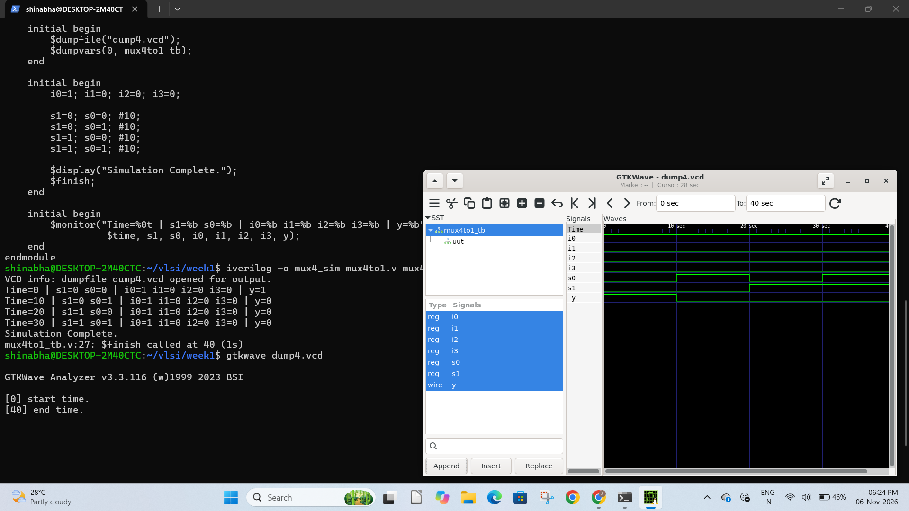

### GTKWave Waveform
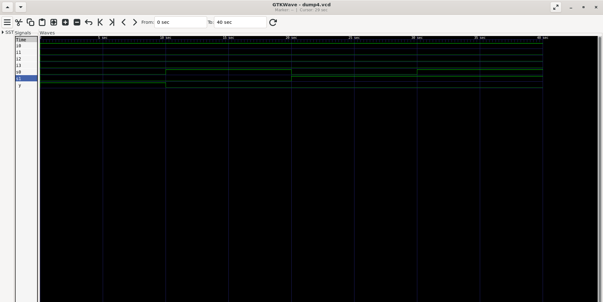

### HDLBits Verification
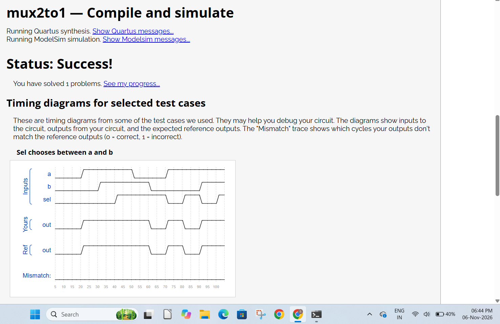

### Verification — All test cases passed ✓
| Time | s1 | s0 | i0 | i1 | i2 | i3 | y | Result |
|------|----|----|----|----|----|-----|---|--------|
| 0s   | 0  | 0  | 1  | x  | x  | x  | 1 | ✓ |
| 10s  | 0  | 1  | x  | 0  | x  | x  | 0 | ✓ |
| 20s  | 1  | 0  | x  | x  | 0  | x  | 0 | ✓ |
| 30s  | 1  | 1  | x  | x  | x  | 0  | 0 | ✓ |

### What I learned
- How to extend a 2:1 MUX to 4:1 using 2 select lines
- Two select lines can encode 4 states: 00, 01, 10, 11
- HDLBits runs your Verilog against hundreds of hidden test cases
- Mismatch = 0 means every single one passed

---

## 🏆 HDLBits Progress
| Problem | Status |
|---------|--------|
| 2:1 MUX (mux2to1) | ✅ Solved |
| 2:1 MUX — 100-bit input [99:0] | Multiplexer (bus) | ✅ Solved |
---

## ✅ Project 3 — 4-bit Adder
**Date:** 07 Nov 2026

### What is a 4-bit Adder?
Adds two 4-bit numbers (a, b) and produces a 4-bit sum
and a carry_out bit for overflow detection.
- If result exceeds 4 bits (>15), carry_out = 1

### Terminal Output
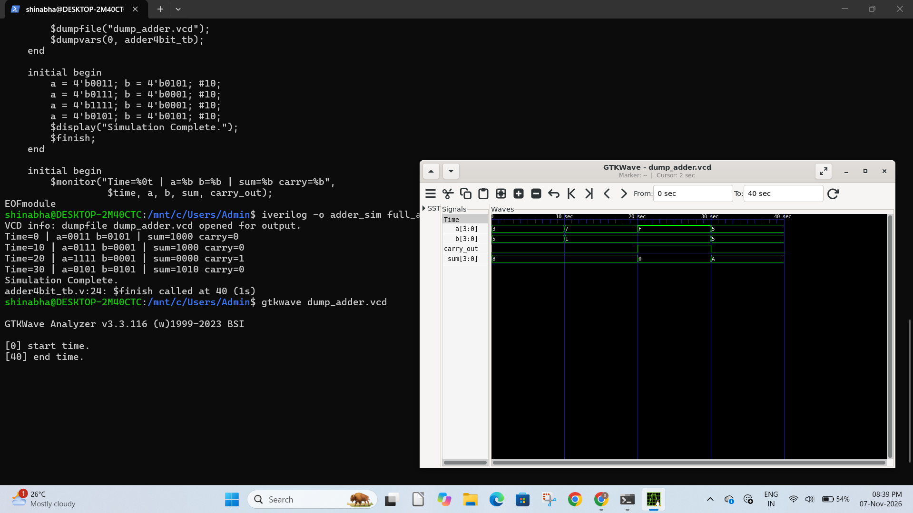

### GTKWave Waveform
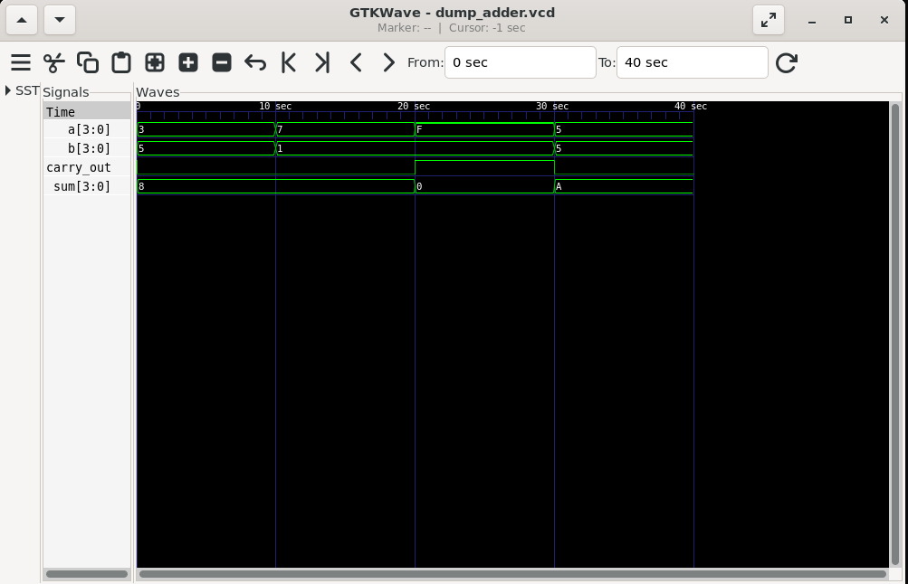

### Verification — All 4 test cases passed ✓
| a | b | sum | carry | Check |
|---|---|-----|-------|-------|
| 3 | 5 | 8   | 0 | ✓ |
| 7 | 1 | 8   | 0 | ✓ |
| 15 | 1 | 0  | 1 | ✓ overflow |
| 5 | 5 | 10  | 0 | ✓ |

### What I learned
- `assign {carry_out, sum} = a + b` — concatenation operator
  packs carry and sum into one expression
- Overflow: when two 4-bit numbers exceed 15, carry_out = 1
- GTKWave shows bus values in hex by default —
  'F' means 15, 'A' means 10, '8' means 8

---

## 🏆 HDLBits Progress
| Problem | Topic | Status |
|---------|-------|--------|
| 2:1 MUX — single bit input | Multiplexer | ✅ Solved |
| 2:1 MUX — 100-bit input [99:0] | Multiplexer (bus) | ✅ Solved |
| Half Adder (hadd) | Combinational Logic | ✅ Solved |

### Half Adder — HDLBits Result
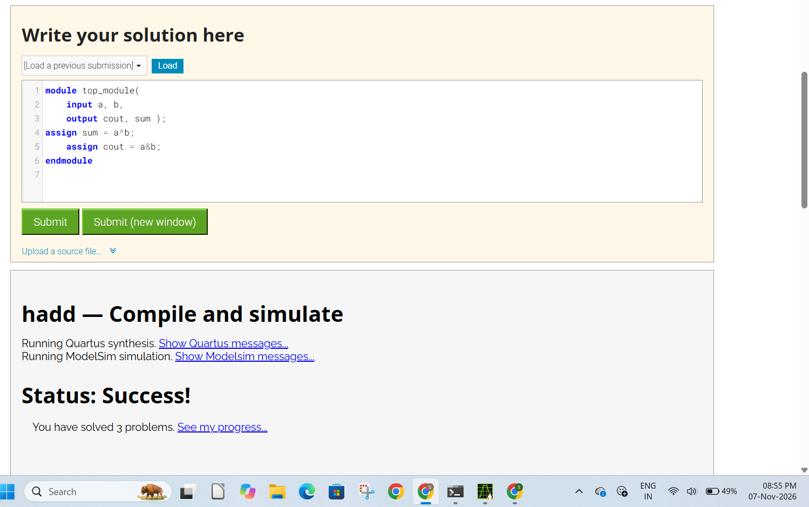
---

## ✅ Week 2 — Sequential Logic

## ✅ Project 4 — D Flip-Flop (DFF)
**Date:** 08 Nov 2026

### What is a D Flip-Flop?
The most fundamental memory element in digital design.
Unlike combinational circuits (MUX, Adder) that respond
instantly to inputs, a DFF captures input only at the
rising edge of the clock — and holds that value until
the next rising edge.

- Combinational: output changes immediately when input changes
- Sequential: output changes only on clock rising edge

This is how ALL registers, CPUs, and memory work at the
hardware level.

### Key Verilog Concept
```verilog
always @(posedge clk) begin
    q <= d;    // non-blocking assignment
end
```
`<=` is non-blocking assignment — used inside clocked
always blocks. This is different from `=` (blocking).

### Terminal Output
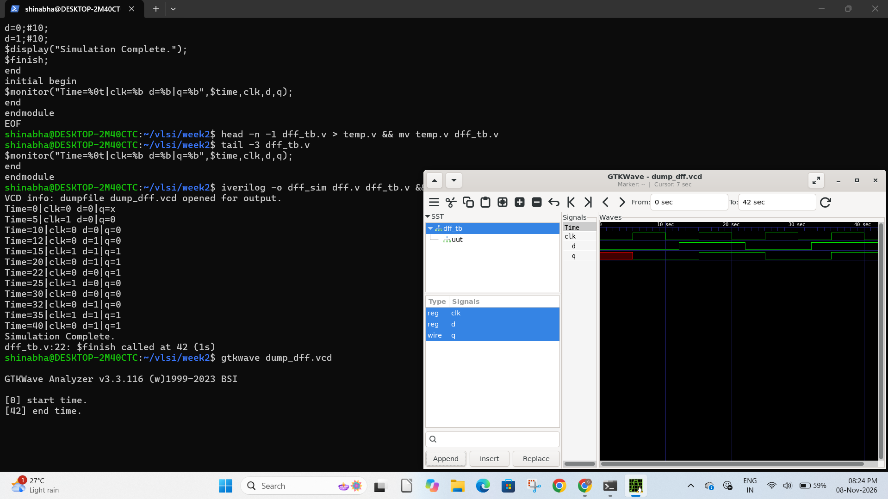

### GTKWave Waveform
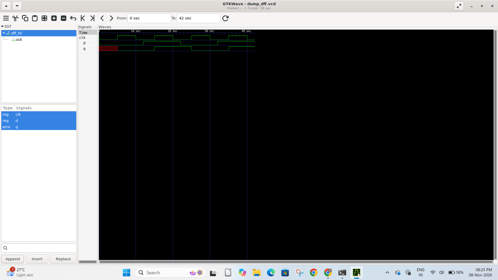

### HDLBits — DFF Result
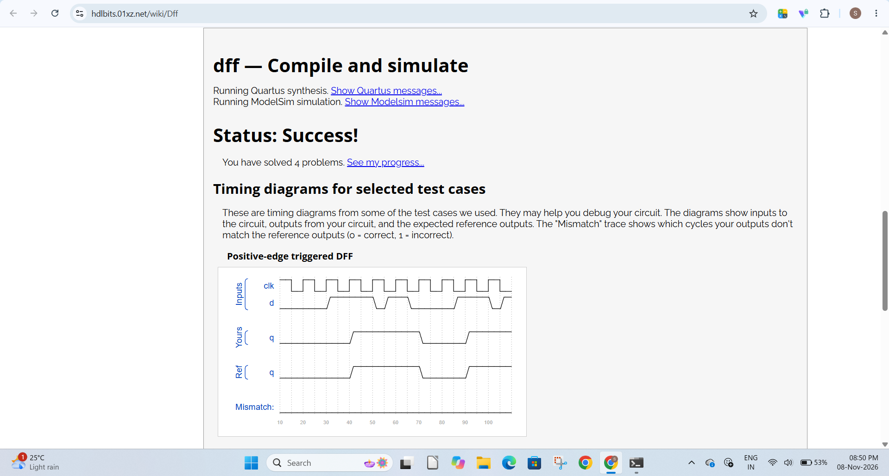

### What I learned
- `always @(posedge clk)` — triggers only on rising clock edge
- `<=` non-blocking vs `=` blocking assignment
- Unknown state `x` (red in GTKWave) — flip-flop has no
  value before first clock edge
- Sequential circuits have MEMORY — output depends on
  both current input AND previous state
- This is the building block of every register, CPU
  pipeline stage, and state machine

---

## 🏆 HDLBits Progress
| Problem | Topic | Status |
|---------|-------|--------|
| 2:1 MUX — single bit | Multiplexer | ✅ Solved |
| 2:1 MUX — 100-bit [99:0] | Multiplexer (bus) | ✅ Solved |
| Half Adder (hadd) | Combinational Logic | ✅ Solved |
| D Flip-Flop (dff) | Sequential Logic | ✅ Solved |
---

## ✅ Project 5 — 4-bit Register
**Date:** 09 Nov 2026

### What is a 4-bit Register?
Four D Flip-Flops connected in parallel — stores a
4-bit value on every rising clock edge.
Adds a synchronous reset: when rst=1, output clears
to 0000 on the next rising clock edge.

### Terminal Output
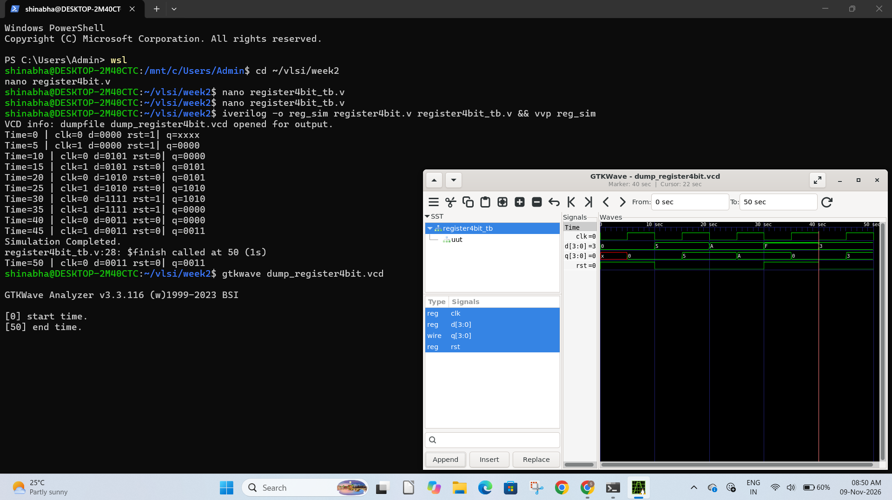

### GTKWave Waveform
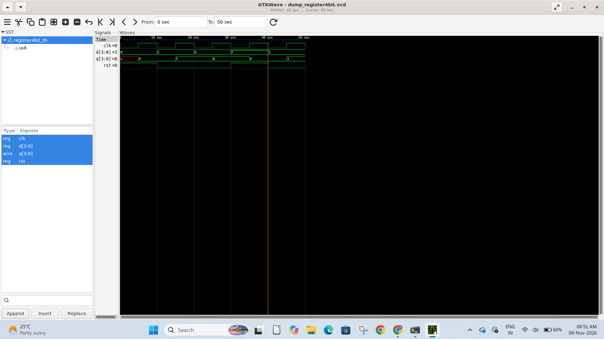

### HDLBits — 8-bit Register (dff8)
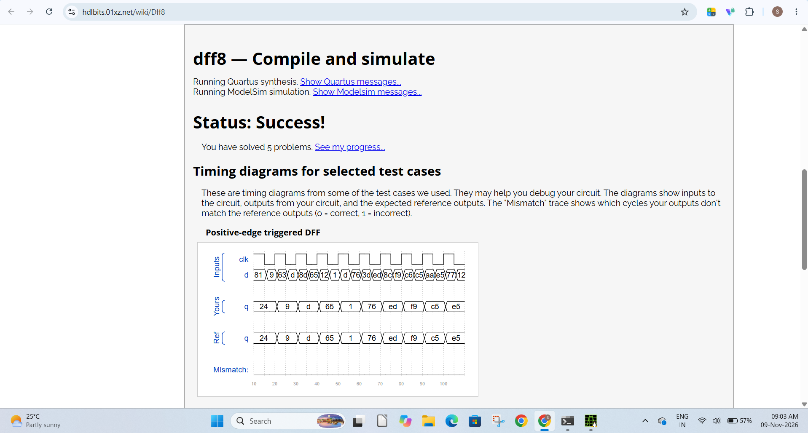

### Verification — All test cases passed ✓
| d (hex) | rst | q (hex) | Result |
|---------|-----|---------|--------|
| 0 | 1 | 0 | ✓ reset |
| 5 | 0 | 5 | ✓ captured |
| A | 0 | A | ✓ captured |
| F | 1 | 0 | ✓ reset mid-op |
| 3 | 0 | 3 | ✓ captured |

### What I learned
- A register = multiple flip-flops working in parallel
- Synchronous reset: clears output only on rising clock edge
- GTKWave shows bus values in hex: A=10, F=15
- `q <= 0` inside clocked block = synchronous clear
- One `always @(posedge clk)` block controls all 4 bits

---

## 🏆 HDLBits Progress
| Problem | Topic | Status |
|---------|-------|--------|
| 2:1 MUX — single bit | Multiplexer | ✅ Solved |
| 2:1 MUX — 100-bit [99:0] | Multiplexer (bus) | ✅ Solved |
| Half Adder (hadd) | Combinational Logic | ✅ Solved |
| D Flip-Flop (dff) | Sequential Logic | ✅ Solved |
| 8-bit Register (dff8) | Sequential Logic | ✅ Solved |
---

## ✅ Project 6 — 4-bit Counter
**Date:** 10 Nov 2026

### What is a 4-bit Counter?
A sequential circuit that increments its value by 1
on every rising clock edge — counting 0→1→2→...→F→0.
Wraps around automatically at 15 (1111) back to 0 (0000).
Synchronous reset clears count to 0 on next rising edge.

### Terminal Output
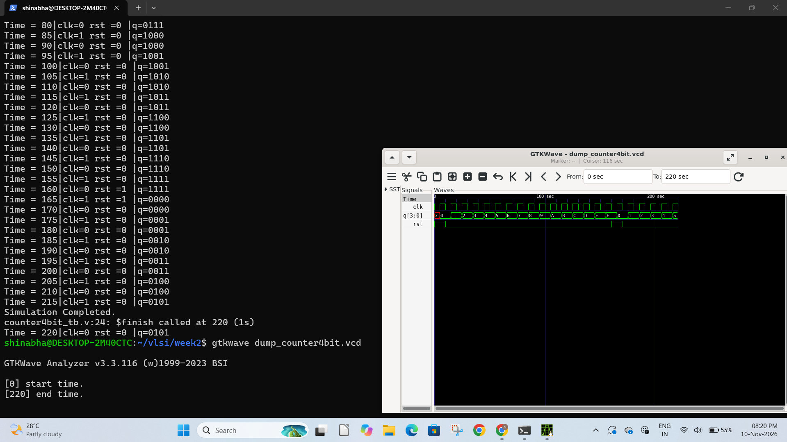

### GTKWave Waveform
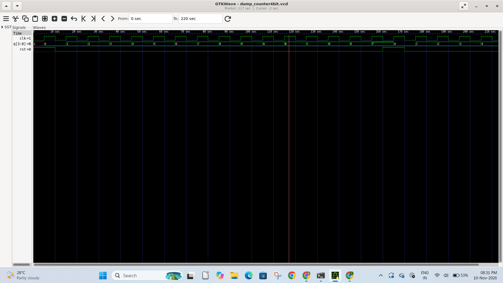

### HDLBits — count15
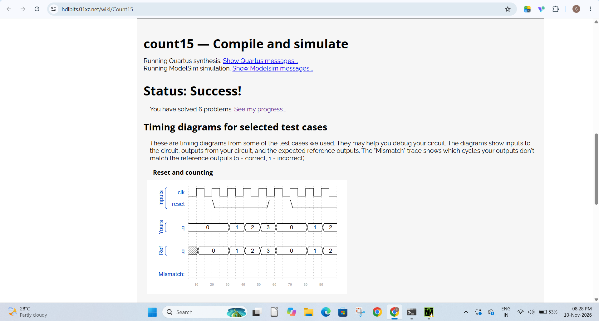

### What I learned
- `q <= q + 1` increments a register each clock cycle
- Counter wraps: 1111 + 1 = 10000, but only 4 bits
  stored so it becomes 0000 automatically
- Full count sequence visible in GTKWave:
  0→1→2→3→4→5→6→7→8→9→A→B→C→D→E→F→0
- Reset at any point mid-count → immediately back to 0
- This is the foundation of timers and PWM in real hardware

---

## 🏆 HDLBits Progress
| Problem | Topic | Status |
|---------|-------|--------|
| 2:1 MUX — single bit | Multiplexer | ✅ Solved |
| 2:1 MUX — 100-bit [99:0] | Multiplexer (bus) | ✅ Solved |
| Half Adder (hadd) | Combinational Logic | ✅ Solved |
| D Flip-Flop (dff) | Sequential Logic | ✅ Solved |
| 8-bit Register (dff8) | Sequential Logic | ✅ Solved |
| 4-bit Counter (count15) | Sequential Logic | ✅ Solved |

---

## ✅ Week 3 — FSM Design

## ✅ Project 7 — Traffic Light Controller (FSM)
**Date:** 11 Nov 2026

### What is an FSM?
A Finite State Machine — a circuit that moves between
defined states based on clock and inputs.
Unlike a counter (which just increments), an FSM can
make decisions and follow different paths.

Traffic Light states:
- 00 = RED   (stop)
- 01 = GREEN (go)
- 10 = YELLOW (slow down)

Cycle: RED → GREEN → YELLOW → RED → ...

### Terminal Output
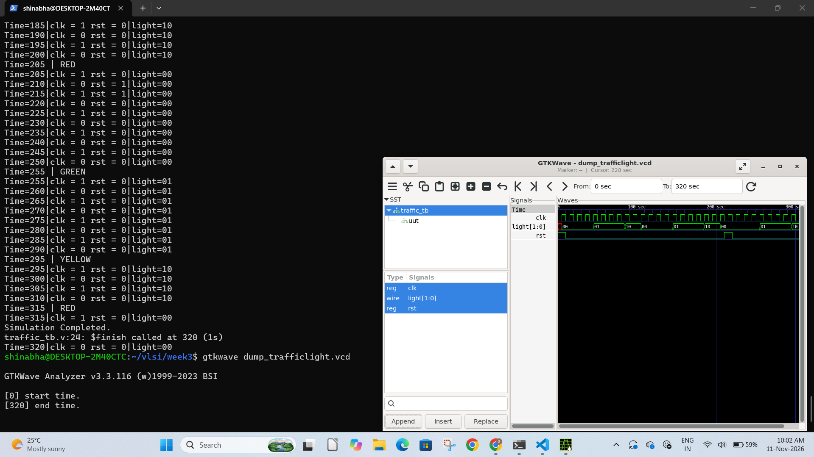

### GTKWave Waveform
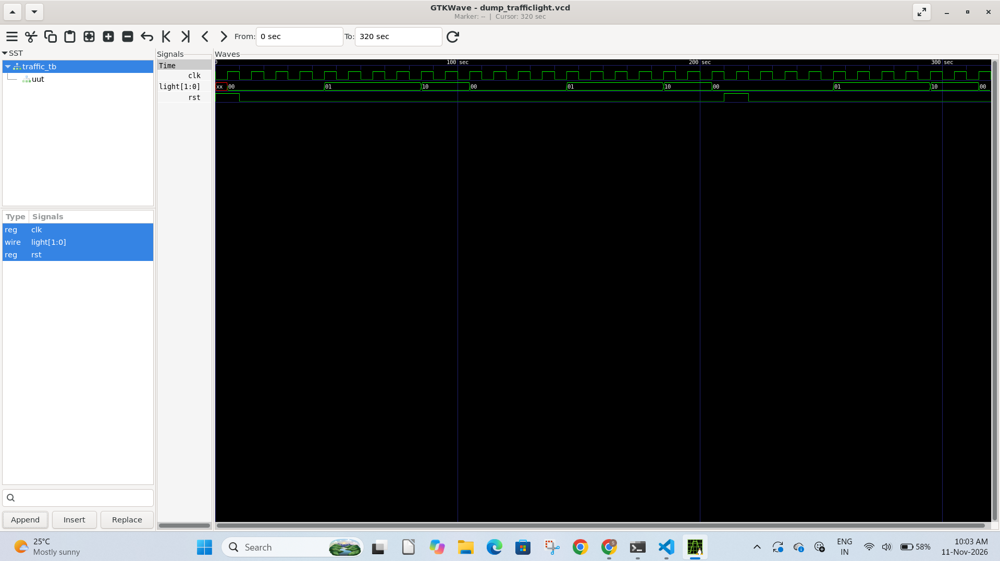

### Verification ✓
- State transitions: RED→GREEN→YELLOW→RED cycling ✓
- Reset at any state → returns to RED immediately ✓
- light[1:0] encoding correct: 00/01/10 ✓

### What I learned
- FSM needs two always blocks:
  (1) sequential: state register (clocked)
  (2) combinational: next state logic + output logic
- Moore machine: output depends only on current state
- State encoding: 2 bits can represent 4 states
- Reset forces FSM to known initial state — critical
  for real hardware startup behaviour
- This is how CPU control units, protocol handlers,
  and digital controllers work at RTL level
