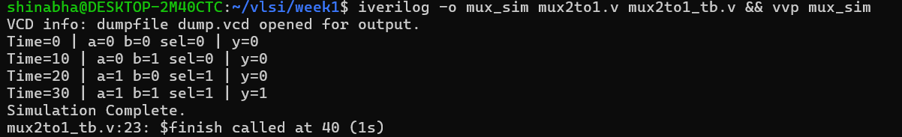
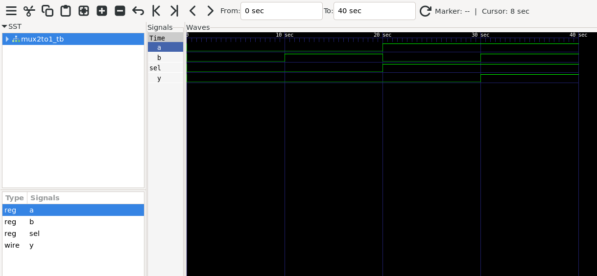

---

## ✅ Project 1 — 2:1 MUX (Multiplexer)
**Date:** 03 Oct 2026

### What is a 2:1 MUX?
A selector circuit with 2 inputs (a, b), 1 select line (sel),
and 1 output (y).
- sel=0 → output follows a
- sel=1 → output follows b

### Verilog Code
```verilog
module mux2to1(
  input a, b, sel,
  output y
);
  assign y = sel ? b : a;
endmodule
```

### Terminal Output


### GTKWave Waveform


### Verification — All 4 test cases passed ✓
| Time | a | b | sel | y | Expected | Result |
|------|---|---|-----|---|----------|--------|
| 0s   | 0 | 0 |  0  | 0 |    0     | ✓ |
| 10s  | 0 | 1 |  0  | 0 |    0     | ✓ |
| 20s  | 1 | 0 |  1  | 0 |    0     | ✓ |
| 30s  | 1 | 1 |  1  | 1 |    1     | ✓ |

### What I learned
- `assign` = continuous hardware connection, not a software assignment
- Ternary operator `sel ? b : a` maps directly to MUX logic
- Difference between `wire` (combinational output) and `reg` (testbench inputs)
- How to dump `.vcd` file and read waveforms in GTKWave
